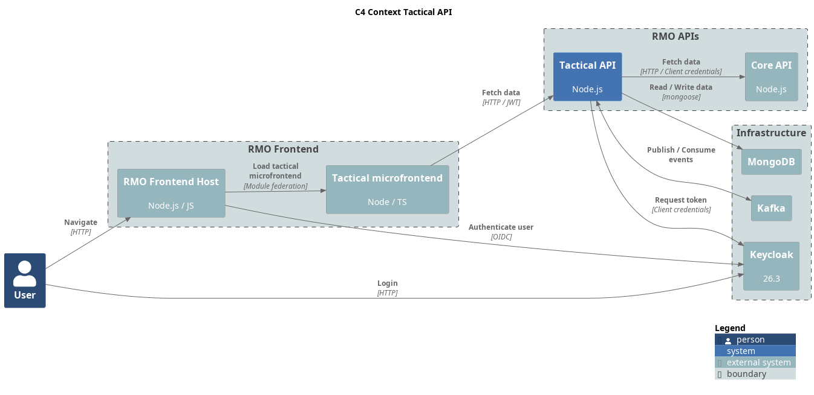

= RMU Engine Tactical API
:linkattrs:
:icons: font

image:https://img.shields.io/badge/license-GPL3.0-green.svg[License,link="https://www.gnu.org/licenses/gpl-3.0.html"]
image:https://img.shields.io/badge/rolemaster-rmu-green.svg[Rolemaster,link="http://ironcrown.co.uk/unified-rolemaster/"]
image:https://img.shields.io/badge/NestJS-12-green?logo=nestjs[NestJS, link="https://nestjs.com"]

++++
<a href="https://www.postman.com/labcabrera/workspace/rmu-engine/collection/5547717-39d04dee-7325-4251-86e5-e1f250cd99f2?action=share&creator=5547717&active-environment=5547717-f0da278a-5cc7-4d6c-8a82-8739ae0d1b0b" target="_blank">
  
</a>
++++

REST API for combat management. Each combat (tacticalGame) is associated to a campaign (strategicGame) of the
Strategic API module.

This API allows to import characters from the strategic API or to create NPC characters. Once the characters
are defined, it allow the declaration of actions such as maneuvers or attacks.

This project is part of RMU Online: https://github.com/labcabrera/rmu-platform

WARNING: *This application is an independent project developed by fans of Rolemaster Unified. It is not affiliated with, endorsed by, or licensed by Iron Crown Enterprises (ICE), the owners of the Rolemaster intellectual property.*
*All Rolemaster trademarks, game systems, and materials are the property of Iron Crown Enterprises. This software is provided for personal, non-commercial use only. If you enjoy Rolemaster, please support the official publications and content from ICE.*




== Technologies

* NestJS
* DDD
* CQRS
* MongoDB
* Kafka

== Development

This API follows the platform and conventions of https://github.com/labcabrera/rmu-api-core[rmu-api-core] (workspace
spec 020): Node.js 24 (`nvm use`), pnpm 10 through corepack, native ESM with relative `.js` imports, SWC build, Vitest
and the hexagonal + CQRS layout of core's README (*Project layout*, *HTTP contract*).

```bash
cp .env.example .env   # host ports of the rmu-platform infrastructure (make up-infra)
pnpm install
pnpm start:dev         # http://localhost:3003, Swagger UI on /api-docs, OpenAPI JSON on /api-spec
make check             # lint, typecheck, unit and e2e tests
```

[cols="1,3"]
|===
| Command | What it does

| `pnpm build` / `pnpm typecheck` | SWC build to `dist/` / `tsc --noEmit`
| `pnpm lint` / `pnpm format` | typed ESLint + Prettier / Prettier over `src` and `test`
| `pnpm test` | unit tests (`test/unit`)
| `pnpm test:e2e` | one file per resource booting `AppModule` against mongodb-memory-server, with tokens signed against a local JWKS; calls to other APIs and the Kafka producer are replaced (`test/e2e/support`)
| `pnpm test:cov` | unit and e2e tests with the coverage thresholds of `vitest.config.ts` (what CI runs)
| `make docker-build` / `make docker-run` | image `labcabrera/rmu-api-tactical:latest` (`node:24-bookworm-slim`, `node` user, `HEALTHCHECK`); `docker-run` needs `.env.docker`
| `make create-release` | semantic-release from a clean `develop` into `main`
|===

The Joi schema in `src/config/env.schema.ts` fails startup on a missing required variable. Besides `PORT` (`3003`),
`LOG_LEVEL` (`info`) and `RMU_MONGO_TACTICAL_URI`, the HTTP layer reads `RMU_CORS_ORIGINS` (empty: no CORS, browsers come through the
gateway), `RMU_THROTTLE_LIMIT` / `RMU_THROTTLE_TTL_MS` (`300` per `60000` ms and client IP, `0` turns it off) and
`RMU_TRUST_PROXY` (`loopback, linklocal, uniquelocal`).

Errors answer `{ statusCode, error, code, message, timestamp, path }`. Responses carry the `version` of the entity and a
`PATCH` may send it back: a stale one is a 409 `version-conflict`. `size` goes up to 100. `GET /v1/actions` accepts up to 1000 (`CatalogPagedQueryDto`), because rmu-mfe-tactical loads a round whole. Error bodies also carry the deprecated `errorCode` (same value as `code`) and `details`, which rmu-mfe-tactical still reads.
== Permissions

Workspace spec 021, decision 2, over the `BaseEntityGuard` of every API (`shared/infrastructure/security`):

* A tactical game is managed (changed, played, finished, deleted, its factions and actors) by its owner, the owner of
  its strategic game or a `rmu-admin`. Creating one needs `rmu-user` or `rmu-admin`.
* It is read as its strategic game says (`accessType`): a public one by everybody, a private one by its managers, the
  owners of its actors and the admins. Listings of games, actor rounds and actions only return what the user reads.
* The owner of a character acts for its actor: declares and resolves its actions and changes its actor round. A
  defender declares a parry on the attacker's action as long as it owns an actor of the game.

The checks run at the HTTP edge (`GameAccessGuard`, `ActorRoundAccessGuard`, `ActionAccessGuard` over the
`GameGuardPort`), not in the command handlers: a handler runs commands of its own on actors the caller does not own (an
attack damages its target). The service account token carries `rmu-admin`.

The game stores `strategicGameOwner` and `accessType`, copied from the strategic game when the game is created, so the
checks make no call to strategic. Games created before spec 021 have neither: until they are migrated, only their owner
and the admins manage them, and they read as private. The migration is a mongosh script run from rmu-platform:

```bash
# in rmu-platform, after make mongo-backup
make mongo-migrate f=../rmu-api-tactical/scripts/migrations/021-tactical-game-strategic-owner.js DRY_RUN=1
make mongo-migrate f=../rmu-api-tactical/scripts/migrations/021-tactical-game-strategic-owner.js
```

Open problems found during the migration are listed in `docs/reports/api-template-rollout-findings.md` of the workspace.
